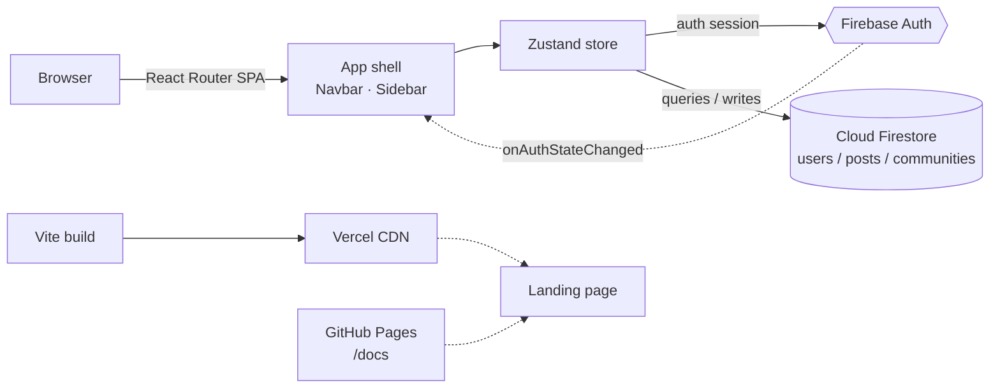

<div align="center">

# VIT Connect

**For the People. By the People. Of the People.**

[](https://vit-connect.vercel.app)
[](https://real-ds.github.io/vit-connect/)
[](https://react.dev)
[](https://www.typescriptlang.org)
[](https://firebase.google.com)
[](https://vercel.com)

A campus social forum for VIT students, faculty, clubs and departments —
one searchable feed instead of forty dying group chats.

[**Open the app ↗**](https://vit-connect.vercel.app) · [**Landing page ↗**](https://real-ds.github.io/vit-connect/) · [**Privacy**](https://real-ds.github.io/vit-connect/privacy.html) · [**Terms**](https://real-ds.github.io/vit-connect/terms.html) · [**Report an issue**](https://github.com/real-ds/vit-connect/issues/new) · [**Source**](https://github.com/real-ds/vit-connect)

</div>

---

## Contents

| # | Section | # | Section |
|---|---------|---|---------|
| 1 | [At a glance](#1-at-a-glance) | 7 | [Architecture](#7-architecture) |
| 2 | [Problem](#2-problem) | 8 | [Tech stack](#8-tech-stack) |
| 3 | [Solution](#3-solution) | 9 | [Getting started](#9-getting-started) |
| 4 | [Users and why](#4-users-and-why) | 10 | [Deployment](#10-deployment) |
| 5 | [Functional requirements](#5-functional-requirements-ids) | 11 | [Roadmap](#11-roadmap) |
| 6 | [Scope](#6-scope) | 12 | [Known issues](#12-known-issues) |
| | | 13 | [Contributing](#13-contributing) |

---

<a id="1-at-a-glance"></a>

## 1. At a glance

| Field | Value |
|---|---|
| **Type** | Campus social network / discussion forum (SPA) |
| **Stage** | v0.1 — beta, auth + feed + communities + profiles live |
| **Frontend** | React 18, TypeScript 5.6, Vite 5, Tailwind CSS 3 |
| **State** | Zustand 5 — single store |
| **Backend** | Firebase Auth + Cloud Firestore (serverless) |
| **Routing** | React Router 6 |
| **Web live at** | [vit-connect.vercel.app](https://vit-connect.vercel.app) |
| **Landing page** | [real-ds.github.io/vit-connect](https://real-ds.github.io/vit-connect/) — GitHub Pages, built from [`/docs`](docs/) |
| **Legal pages** | [Privacy](https://real-ds.github.io/vit-connect/privacy.html) · [Terms](https://real-ds.github.io/vit-connect/terms.html) — same Pages site, sources in [`docs/privacy.html`](docs/privacy.html) and [`docs/terms.html`](docs/terms.html) |
| **Repository** | [github.com/real-ds/vit-connect](https://github.com/real-ds/vit-connect) |
| **Maintainer** | [@real-ds](https://github.com/real-ds) |
| **License** | None yet — add one before inviting outside contributions |

---

<a id="2-problem"></a>

## 2. Problem

Campus communication runs on private messaging apps. That produces three predictable failures:

1. **Information is unsearchable.** A notice posted in April cannot be found in September. New members never see it.
2. **Audience fragmentation.** The same announcement is retyped into the CS group, the year group, and three department chats. Some of them get it; most don't.
3. **No attribution.** A screenshot of a schedule change has no author and no date, so nobody can tell whether it is still true.

Every general-purpose social network solves the opposite problem: unlimited reach, which makes campus information *less* trustworthy, not more.

---

<a id="3-solution"></a>

## 3. Solution

VIT Connect is a forum with a closed door. Membership is limited to people who already share a campus, which removes the reason public platforms become noisy — and makes the remaining content worth reading.

| Surface | What it does |
|---|---|
| **Feed** | All posts campus-wide, newest first, unfiltered. No ranking algorithm. |
| **Communities** | Topic spaces mapped to real affiliations — CS, Campus Life, Research, Clubs. Joinable, and creatable if none exists. |
| **Posts** | Title + body, authored, community-scoped, timestamped, liked. |
| **Profiles** | Name, department, bio, LinkedIn, GitHub — identity that carries context into every post. |
| **Search** | Live filtering across posts, communities and people from the navbar. |

---

<a id="4-users-and-why"></a>

## 4. Users and why

| Persona | Primary need | Why VIT Connect |
|---|---|---|
| **Students** | Find study partners, ask a lecture question at 2am, catch event notices before the WhatsApp forward | One searchable thread instead of scrolling five chats |
| **Faculty & TAs** | Announce once, to everyone, in a way that stays findable | Removes repeat questions and re-typed announcements |
| **Clubs & departments** | Reach the people who actually opted in | A community is a durable, joinable audience — not an invite link that expires |
| **Admins** | One official surface for campus-wide information | Content is attributed, ordered and permanent rather than ephemeral |

---

<a id="5-functional-requirements-ids"></a>

## 5. Functional requirements

**Status** — ✅ shipped · 🟡 partial · ⬜ not started

| ID | Requirement | Priority | Status | Source |
|---|---|---|---|---|
| FR-01 | Sign up / sign in with email + password | Must | ✅ | [`Auth.tsx`](src/components/Auth.tsx) |
| FR-02 | Sign in with Google (popup) | Should | ✅ | [`Auth.tsx`](src/components/Auth.tsx) |
| FR-03 | Auto-provision a user document on first login | Must | ✅ | [`App.tsx:26`](src/App.tsx#L26) |
| FR-04 | Sign out and clear session | Must | ✅ | [`Navbar.tsx:19`](src/components/Navbar.tsx#L19) |
| FR-05 | Campus-wide feed, newest first | Must | ✅ | [`Feed.tsx`](src/components/Feed.tsx) |
| FR-06 | Load more posts on scroll (infinite feed) | Should | 🟡 | [`useStore.ts:227`](src/store/useStore.ts#L227) |
| FR-07 | Browse and search communities | Must | ✅ | [`Communities.tsx`](src/components/Communities.tsx) |
| FR-08 | Create a community | Should | ✅ | [`CreateCommunity.tsx`](src/components/CreateCommunity.tsx) |
| FR-09 | Join a community | Must | ✅ | [`useStore.ts:180`](src/store/useStore.ts#L180) |
| FR-10 | View a single community and its posts | Must | ✅ | [`CommunityView.tsx`](src/components/CommunityView.tsx) |
| FR-11 | Create a post inside a community | Must | ✅ | [`PostForm.tsx`](src/components/PostForm.tsx) |
| FR-12 | Create a post from the main feed | Should | ⬜ | no composer in [`Feed.tsx`](src/components/Feed.tsx) |
| FR-13 | Like a post | Must | ✅ | [`useStore.ts:204`](src/store/useStore.ts#L204) |
| FR-14 | Unlike a post / one like per user | Must | ⬜ | counter-only, no user tracking |
| FR-15 | Comment on a post | Must | 🟡 | read-only render, no compose path |
| FR-16 | Share a post | Should | ⬜ | inert button |
| FR-17 | Edit profile (name, department, bio, links) | Must | ✅ | [`Profile.tsx`](src/components/Profile.tsx) |
| FR-18 | Attach a resume URL to the profile | Should | 🟡 | in the model, no input rendered |
| FR-19 | Global search over posts / communities / users | Should | ✅ | [`useStore.ts:170`](src/store/useStore.ts#L170) |
| FR-20 | Open a post or a user from search results | Must | ⬜ | dead routes, see [KI-02](#12-known-issues) |
| FR-21 | Admin / faculty role with write permissions | Should | ⬜ | `role` field exists, no UI, no rules |

### Non-functional

| ID | Requirement | Status |
|---|---|---|
| NFR-01 | Responsive from 360px to ultrawide | ✅ Tailwind breakpoints throughout |
| NFR-02 | No custom server required | ✅ Fully client-side + Firebase |
| NFR-03 | Typed domain models | ✅ [`types.ts`](src/types.ts) |
| NFR-04 | SPA deep links resolve on refresh | ✅ [`vercel.json`](vercel.json) rewrite |
| NFR-05 | Secrets never committed | ⚠️ gitignored going forward — see [KI-09](#12-known-issues) |
| NFR-06 | Firestore security rules enforced server-side | ⬜ not shipped |

---

<a id="6-scope"></a>

## 6. Scope

**In scope for v0.1** — authenticated campus forum: feed, communities, posts, likes, profiles, client-side search.

**Deliberately out of scope** — direct messaging, notifications, media uploads, moderation tooling, mobile app, i18n, analytics.

---

<a id="7-architecture"></a>

## 7. Architecture



### Data model

All timestamps are ISO-8601 strings. See [`types.ts`](src/types.ts).

| `users` | `posts` | `communities` |
|---|---|---|
| `id` (auth uid) | `id` (auto) | `id` (auto) |
| `name` | `title`, `content` | `name`, `description` |
| `email` | `communityId` ↔ `communities.id` | `category` |
| `avatar` | `communityName` (denormalised) | `members[]` → `users.id` |
| `role` (`student`) | `authorId` → `users.id` | `avatar` |
| `department`, `bio` | `likes` | `createdAt`, `updatedAt` |
| `socialLinks` (LinkedIn, GitHub) | `comments[]` | |
| `resumeUrl`, `createdAt` | `createdAt`, `updatedAt` | |

**Component map** — [`App.tsx`](src/App.tsx) mounts `Navbar` + `Sidebar` and routes to [`Feed`](src/components/Feed.tsx), [`Communities`](src/components/Communities.tsx), [`CommunityView`](src/components/CommunityView.tsx), [`Profile`](src/components/Profile.tsx). [`Auth`](src/components/Auth.tsx) gates everything behind a session. All data access goes through [`useStore.ts`](src/store/useStore.ts).

---

<a id="8-tech-stack"></a>

## 8. Tech stack

| Layer | Choice | Why |
|---|---|---|
| UI | React 18 | Component model matches the feed / post / profile surfaces |
| Language | TypeScript 5.6 | Catches shape errors across the four domain models |
| Build | Vite 5 | Sub-second dev server, single-command production build |
| State | Zustand 5 | One store, no provider tree, no boilerplate per action |
| Routing | React Router 6 | Four routes, deep-linkable |
| Styling | Tailwind CSS 3 | Responsive by default, no stylesheet to maintain |
| Auth | Firebase Auth | Email/password + Google, zero server code |
| Database | Cloud Firestore | Realtime document store, no server to operate |
| Icons | lucide-react | Consistent icon set |
| Dates | date-fns | Relative timestamps |
| Hosting | Vercel | SPA rewrites + edge CDN |
| **Landing site** | **Vanilla HTML / CSS / JS** | No framework, no bundler, no build step — it runs on GitHub Pages directly |
| Landing type | Inter | Loaded from Google Fonts, single typeface site-wide |
| Landing icons | Simple Icons (CC0) | React, TypeScript, Vite, Tailwind, Firebase and Vercel marks inlined as SVG |
| Landing motion | Vanilla IntersectionObserver | Scroll reveals, `prefers-reduced-motion` respected |

---

<a id="9-getting-started"></a>

## 9. Getting started

**Prerequisite** — Node.js 18+ and a Firebase project with **Authentication** and **Firestore** enabled.

```bash
git clone https://github.com/real-ds/vit-connect.git
cd vit-connect
npm install
npm run dev
```

The app will not start without a Firebase config. Create `src/firebaseConfig.ts` (it is gitignored — each setup supplies its own project):

```ts
import { initializeApp } from 'firebase/app';
import { getFirestore } from 'firebase/firestore';

const firebaseConfig = {
  apiKey: 'your-api-key',
  authDomain: 'your-project.firebaseapp.com',
  projectId: 'your-project',
  storageBucket: 'your-project.appspot.com',
  messagingSenderId: 'your-sender-id',
  appId: 'your-app-id'
};

const app = initializeApp(firebaseConfig);
export const db = getFirestore(app);
export default app;
```

Enable **Email/Password** and **Google** sign-in providers in the Firebase console.

| Script | Does |
|---|---|
| `npm run dev` | Dev server with HMR |
| `npm run build` | Type-check + production bundle → `dist/` |
| `npm run preview` | Serve the production build locally |
| `npm run lint` | ESLint over the source |

---

<a id="10-deployment"></a>

## 10. Deployment

| Target | Source | Config |
|---|---|---|
| **App** → [vit-connect.vercel.app](https://vit-connect.vercel.app) | `main` | [`vercel.json`](vercel.json) rewrites all traffic to `index.html` so deep links work |
| **Landing page** → [real-ds.github.io/vit-connect](https://real-ds.github.io/vit-connect/) | `main` → `/docs` | GitHub Pages, static HTML/CSS/JS, no build step |
| **Legal pages** → [/privacy.html](https://real-ds.github.io/vit-connect/privacy.html) · [/terms.html](https://real-ds.github.io/vit-connect/terms.html) | `main` → `/docs` | Same Pages site; served as plain files |

### The landing site (GitHub Pages)

The landing page is a separate static site that lives in [`docs/`](docs/). It is **not** part of the Vite bundle — `docs/index.html` is not the app entry point, and `npm run build` neither reads it nor writes to it.

| File | Purpose |
|---|---|
| [`docs/index.html`](docs/index.html) | The page. Nav, hero, and four sections: Platform, Community, Why it exists, Under the hood |
| [`docs/style.css`](docs/style.css) | Entire design system — tokens, layout, motion, responsive rules |
| [`docs/script.js`](docs/script.js) | 38 lines: sticky-nav state, scroll reveals, footer year |
| [`docs/vitconnectlogo.svg`](docs/vitconnectlogo.svg) | Wordmark used in the footer (copied from [`public/`](public/)) |
| [`docs/privacy.html`](docs/privacy.html) | Privacy Policy |
| [`docs/terms.html`](docs/terms.html) | Terms & Conditions |

**Design system** — a monochrome palette (`--bg #08090b`, `--fg #f7f7f8`, hairlines at `rgba(255,255,255,.1)`), Inter throughout, and depth from soft white radial glows rather than colour or drop shadows. There is no purple anywhere in the stylesheet, which is enforced by the token set.

**How Pages is configured** — source is the `main` branch, path `/docs`, build type legacy. Nothing runs at publish time; whatever is committed to `docs/` is what gets served, so pushing to `main` redeploys both the app and the landing page on their own.

**To edit it** — change any file in `docs/` and open a PR. No build command, no environment variables, no `npm install`. The one asset to keep in sync is the logo: if you change [`public/vitconnectlogo.svg`](public/vitconnectlogo.svg), copy it to `docs/` as well, or the footer will show a stale mark.

> The Pages site is served from a **public repository**. Treat anything in `docs/` as public — no secrets, no internal URLs.

---

<a id="11-roadmap"></a>

## 11. Roadmap

**Next** — real pagination behind `loadMorePosts`, post and user detail routes so search results resolve, like toggling keyed per user.

**Then** — comment compose, resume input, sharing, Firestore security rules, admin tooling.

**Later** — notifications, media uploads, department-verified accounts, mobile shell.

---

<a id="12-known-issues"></a>

## 12. Known issues

| ID | Issue | Where |
|---|---|---|
| KI-01 | `loadMorePosts` is a stub — the feed stops at the first 10 posts | [`useStore.ts:227`](src/store/useStore.ts#L227) |
| KI-02 | Search results route to `/post/:id` and `/user/:id`, which don't exist | [`Navbar.tsx:112`](src/components/Navbar.tsx#L112) |
| KI-03 | Comments render but cannot be written | [`PostList.tsx:80`](src/components/PostList.tsx#L80) |
| KI-04 | Likes are a plain counter — the same user can like repeatedly | [`useStore.ts:204`](src/store/useStore.ts#L204) |
| KI-05 | `joinCommunity` appends unconditionally, duplicating a uid on rejoin | [`useStore.ts:187`](src/store/useStore.ts#L187) |
| KI-06 | `resumeUrl` is stored but has no input in the profile form | [`Profile.tsx`](src/components/Profile.tsx) |
| KI-07 | `role` defaults to `student` with no admin surface or security rules | [`App.tsx:33`](src/App.tsx#L33) |
| KI-08 | `build-errors.txt` is a stale artifact from an earlier strict config — the build passes | repo root |
| KI-09 | `src/firebaseConfig.ts` was committed before being gitignored; the key is in public history | [`src/firebaseConfig.ts`](src/firebaseConfig.ts) |

---

<a id="13-contributing"></a>

## 13. Contributing

Issues and pull requests are welcome. Before opening a large one, open an issue first so the approach can be agreed on.

**Reporting a bug** — include the route, the browser, and the console output. Most defects in this codebase are one of the [known issues](#12-known-issues) above, so check that list first.

**Working on the app** (`src/`)
- `npm run lint` must pass, and `npm run build` must type-check cleanly.
- Keep the domain models in [`types.ts`](src/types.ts) as the single source of truth; add a field there before adding it anywhere else.
- All Firestore access goes through [`useStore.ts`](src/store/useStore.ts). Components read from the store, they don't query the database directly.
- Any schema change to `posts`, `users` or `communities` needs a matching update to the data model table in [§7](#7-architecture).

**Working on the landing site** (`docs/`)
- Plain HTML, CSS and JavaScript only — **no framework, no bundler, no build step**. If a change needs a compile step, it belongs in the app instead.
- Keep the palette monochrome. Do not reintroduce colour accents or gradients; the design system in [§10](#10-deployment) explains why.
- Check your change at 390px, 700px, 1000px and 1440px before opening the PR.
- Mirror asset changes from `public/` into `docs/`.

**Security** — never commit Firebase credentials or API keys. `src/firebaseConfig.ts` is gitignored; each setup supplies its own project config. See [KI-09](#12-known-issues) for the one already in history.

**Legal pages** — [`docs/privacy.html`](docs/privacy.html) and [`docs/terms.html`](docs/terms.html) describe what the software actually does. If you change what data is collected or stored, update them in the same PR — they are not boilerplate.

---

<div align="center">

**Built by [@real-ds](https://github.com/real-ds)** · [App](https://vit-connect.vercel.app) · [Landing page](https://real-ds.github.io/vit-connect/) · [Privacy](https://real-ds.github.io/vit-connect/privacy.html) · [Terms](https://real-ds.github.io/vit-connect/terms.html) · [Issues](https://github.com/real-ds/vit-connect/issues)

</div>
